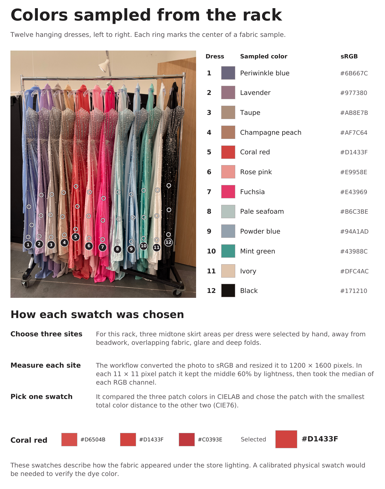

# Dress color workflow

A worker takes a style ID, a worn photograph and one or more rack photographs. It produces a registered base portrait, numbered fabric samples, a review page and one inventory record per observed dress. The render stage requests one Ideogram 4.5 Precise Edit per eligible color. Every output starts as a merchant-review asset.

## Finished portraits

[Comparison PDF](output/pdf/pink-gown-original-and-revised.pdf) · [Rack color diagram](output/rack-color-sampling.png) · [All twelve portraits](final/review.html) · [Inventory manifest](final/manifest.json)

The PDF opens with same-scale views of the original pink gown and the revised portrait. Page 4 shows the photographed rack and its twelve measured colors. Page 5 links to the finished portraits. The final page shows the three generated base portraits.

## From rack photograph to swatch



The final batch used three manually reviewed locations per dress. The worker normalized the original rack photograph to sRGB at 1200 × 1600 pixels and sampled an 11 × 11 pixel patch around each location. Within each patch it retained pixels between the 20th and 80th lightness percentiles, then took the median of each RGB channel. It compared the three patch colors in CIELAB using ΔE76 and selected the one with the smallest sum of distances to the other two.

For coral the patches measured `#D6504B`, `#D1433F` and `#C0393E`. The middle patch supplied the swatch. These measurements describe the photograph under store lighting. The manifest stores all three locations and patch colors for each observation. The automatic locator can propose sample sites on new rack photos, and the subsequent pixel measurements use the same algorithm. [Reviewed sites](pilot-inputs/rack-01.json) · [Sampling implementation](dressflow/sampling.py)

## Portrait workflow

Use a full-length synthetic portrait with a visible neckline, hands, scarf and hem. The supplied fitting reference used a synthetic model and the face-free product detail. A prompt for a similar style is “Keep this fictional model’s face, stance and framing. Fit the sheer scarf around her neck with soft contact shadows. Let the ends fall behind the arms. Match the neckline, pearl pattern, boning and gathered hip to the garment reference.”

The worker can also generate a portrait with DWPose and FLUX General Inpainting. It saves the returned portrait directly. The garment mask for recoloring comes from that portrait, either supplied in the job or segmented after generation. Ideogram receives the base, a fabric mask, a rack swatch and an optional local color proof. Its direct response becomes the source render. The worker checks for changes to the skin, hands and background.

For the supplied style, [retouch.json](retouch.json) transfers detail from the interior of the Ideogram fabric onto the fitted portrait. The reviewed portrait supplies the skin, hands, scarf folds and garment edges. The job contains the mask, paired landmarks and front-panel outline. It also adjusts portrait width, the mask and the landmarks together. The fitted shoulder width is 1.087× the worn reference, and the largest measured joint offset is 41 pixels on the 1024 × 1536 canvas. Exact drape and stone detail still require comparison with real worn examples.

## Run

Use Python 3.11+ and a persistent local workspace. Job paths are relative to the job JSON. Run these commands from `dresses/` to rebuild the finished batch and local proofs.

```sh
uv sync --locked
uv run python -m dressflow retouch retouch.json --out final
uv run python -m dressflow prepare pilot.json --out pilot
```

The [stored source-render manifest](funded/manifest.json) records the original twelve Ideogram responses, their receipts and SHA-256 hashes, and the registered fabric reference. The retouch command reads those files locally. The local pose checker downloads its verified model on first use.

For a new paid job, set the worker's server-side `FAL_KEY`. Use a new output directory for each input revision. [example.json](example.json) requests image segmentation, rack sampling and a pose-guided base. [funded.json](funded.json) supplies the reviewed rack sites and a synthetic pose template for this style.

```sh
uv run python -m dressflow prepare example.json --out runs/new-style
uv run python -m dressflow render example.json --out runs/new-style --only rack-01-01
```

## Inventory contract

- Supply `style_id`, `description`, `worn` and `racks`. Provide the style description your team actually uses to distinguish similar garments. A rack image can contain overlapping garments, repeated shades, different rows or unrelated styles.
- Optional inputs include `detail` for merchant comparison, `mask_parts` for coordinated accessories, `headroom_fraction` for a cropped head, `vision_model` and Ideogram `quality`. Set `max_color_edits` to cap the number of completed color variants per input revision. The automatic example allows twelve. Base generation and vision usage are additional. A reviewed `mask`, `annotations` per rack, or a fitted `model_plate` can replace the corresponding generation step. A `pose_template` is a registered synthetic portrait that initializes the FLUX inpaint. Its optional `base_strength` sets the denoising strength. Supply an oriented full-size or working-size garment mask with white foreground; the fitted plate must match the output canvas. The optional `portrait_mask` must match that plate and marks the fabric visible on the model.
- Read the numbered observations after preparation. For catalog association, set `sku_map` to a mapping such as `{"rack-01-10":"STORE-STYLE-123-MINT"}` in a new input revision. The keys identify physical observations within that exact input revision. The values are the store's actual variant IDs. A map selects one observation per SKU. Leave it absent to generate review drafts for every eligible observation. Photographer color labels and hex codes are descriptive metadata.
- Enqueue a job on style-media changes. Call `dressflow.workflow.execute(jobfile, out, render=True, only=None)` or use the CLI. Give each input revision its own output directory on persistent storage. Read `manifest.json`, attach each completed `variants[].image` to its mapped SKU as a draft, and record `sha256`, `receipt.request_id` and `qa`. Use the input revision and SKU as the upsert key. Reserve approval and storefront publication for the inventory system.
- Re-running the same job on the same storage resumes accepted fal request IDs and reuses downloaded assets. The sibling `.cache/` stores request receipts, results and the pose model. A queued request with a lost submission acknowledgement requires checking fal history before another submission. Retain this cache across worker restarts. Local file locks coordinate workers on one host. Multiple hosts would need a shared transactional job store with equivalent claim and receipt semantics.
- `needs_input_review` and `sample_review` identify questionable inputs. `ready_for_ideogram` and `color_proof` describe prepared work. `image` and its receipt appear after the actual generator succeeds. `needs_detail_review` flags a failed image check. `merchant_review` indicates a generated candidate that passed the implemented checks. All records carry `publishable: false`.

## Sampling, generation and checks

1. Apply EXIF orientation and convert embedded ICC profiles to sRGB. Untagged RGB is assumed to be sRGB. Source bytes are hashed for provenance.
2. Segment the dress and requested accessories on the worn photo. DWPose extracts a body-only skeleton. Map its output onto the same canvas as the dress, accounting for the detector’s 64-pixel size rounding. FLUX General Inpainting receives the garment-protected inpaint mask and a ControlNet Union input with `control_mode="pose"`. A registered synthetic portrait may initialize a refinement. MediaPipe measures visible joints independently on the source and generated portraits. Ideogram receives the finished portrait for recoloring. Check joint displacement, shoulder width and visible fabric beyond the portrait mask.
3. Ask the vision model to enumerate physical dresses matching the style, trace each neckline to a skirt and return three normalized midtone points per garment. It must report uncertain counts, overlapping layers, iridescence and multicolor fabric. The prompt works in two dimensions and has no fixed dress count or horizontal sampling bands. A second vision pass checks the numbered overlay against the original rack photo. Both [prompts](dressflow/prompts.py) and the [sampling code](dressflow/sampling.py) are part of the worker.
4. At each point, sample a small patch, discard the brightest and darkest 20% by lightness and take a median. Choose the most representative of those three measured colors using CIELAB distance. Keep all three patch values and their locations. Overlapping picks, strong disagreement, uncertain garments and possible duplicate SKUs go to review. A neutral color card or a measured physical swatch would be needed to calibrate the photographed dye under mixed store lighting.
5. For clearly chromatic source fabric, create a registered local color proof by changing its dominant dye while retaining lightness detail and neutral highlights. Give Ideogram the base, inverse garment mask, physical swatch and optional proof. Always start each edit from the same base. Audit the direct result against the base. Changes outside its garment mask trigger review. The two mask directions follow the [Ideogram edit contract](https://fal.ai/models/ideogram/v4.5/edit/api).
6. Check outside-mask pixel identity, diffuse-fabric color distance and high-frequency detail correlation against the base. The latter screens for redesigns; it cannot certify pearl counts or individual stones. For a neutral source where dyed fabric and neutral embellishments cannot be separated confidently, the worker omits the local proof and requests close inspection of the render.

The numeric thresholds in this prototype are triage settings. Patches spanning more than 16 ΔE76 or unmapped colors closer than 6 ΔE76 trigger review. Generated-color distance above 10 ΔE76 and detail correlation below 0.85 trigger close inspection. The body guide uses a 12% shoulder-width tolerance and a largest-joint displacement of 26% of source shoulder width. These settings need calibration on real styles and lighting conditions.

## Cost and blind validation

The funded configuration uses the Low Ideogram tier at $0.03 per color, or $0.36 for twelve. A 1024 × 1536 FLUX base returned two billable megapixel units at $0.075 per unit. One such base plus twelve edits totals $0.51 before pose extraction, segmentation, vision, retries and staff review. The two FLUX trials in this run used four units. Check the provider usage ledger for invoiced cost. [Ideogram pricing](https://ideogram.ai/blog/ideogram-api-pricing/) · [SAM 3](https://fal.ai/models/fal-ai/sam-3/image) · [vision endpoint](https://fal.ai/models/openrouter/router/vision/api)

For the three-color blind test in the brief, keep the real worn photos of those three colors out of the job, prompts and references. Freeze the mask, pose, rack samples and instructions before rendering. Then compare against the held-out photos under matched lighting. Have a merchandiser score dye, beading, mesh, piping, drape and silhouette per SKU at full resolution, and record passes, retries and actual spend per accepted image. Compare the local proof alongside the Ideogram output to see whether the paid edit improves the result. Only one worn color was supplied for this pilot.

Run the functional checks with `uv run python -m unittest discover -s tests -v`. The tests cover distinct source and portrait masks, direct provider pixels, finger occlusion, rack sampling and queue recovery.
